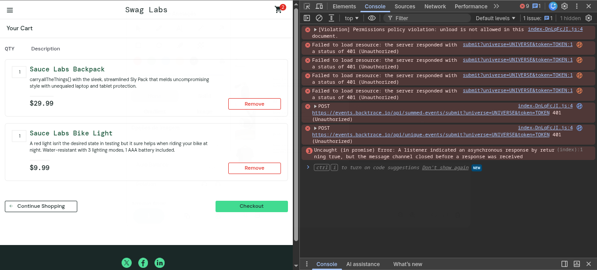
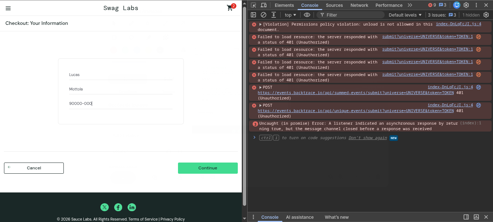
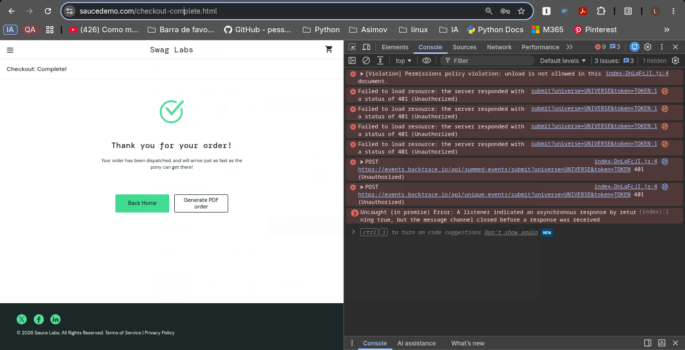

# Relatório de Execução de Teste — Fluxo de Carrinho e Checkout

## Informações Gerais
* **Projeto:** SauceDemo E-Commerce
* **Funcionalidade:** Carrinho de Compras e Checkout Ponta a Ponta
* **QA Responsável:** Lucas Mottola
* **Status Geral:** PASSOU (100% de Aprovação)

## Resumo da Cobertura
| ID | Cenário de Teste | Tipo | Status |
| :--- | :--- | :--- | :--- |
| **CT-001** | Realizar compra de múltiplos produtos com sucesso (Happy Path) | Funcional / E2E | PASS |
| **CT-002** | Validação de campo "First Name" obrigatório no Checkout | Regra de Negócio | PASS |
| **CT-003** | Validação de campo "Last Name" obrigatório no Checkout | Regra de Negócio | PASS |
| **CT-004** | Validação de campo "Postal Code" obrigatório no Checkout | Regra de Negócio | PASS |

## Evidências Visuais

