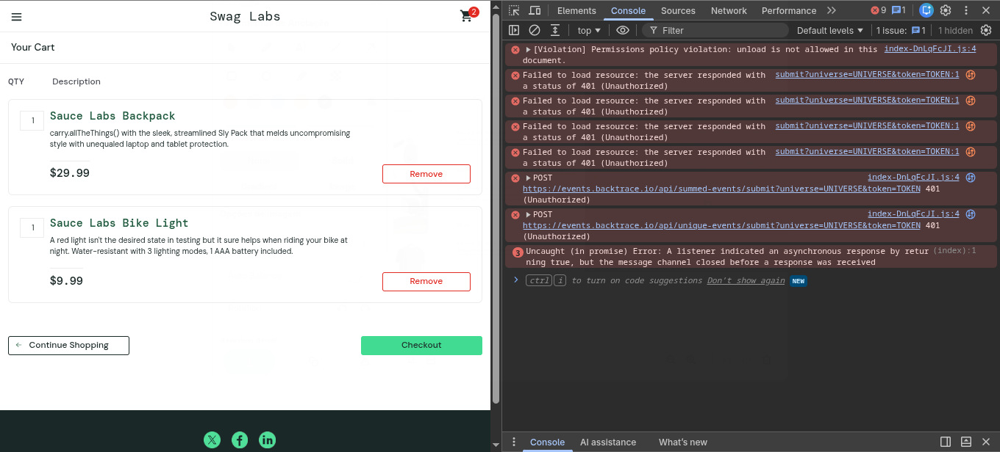
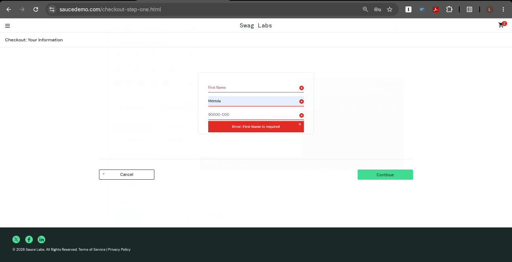
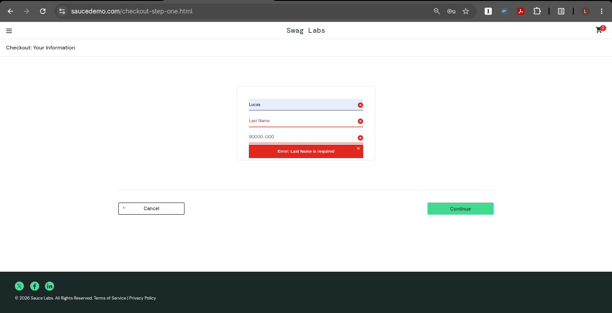
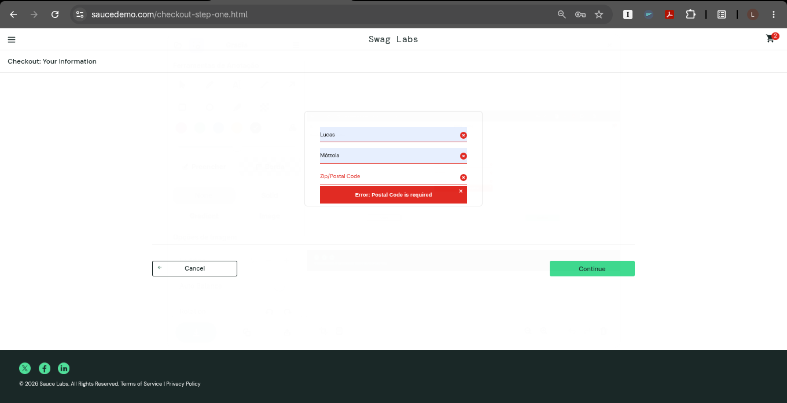
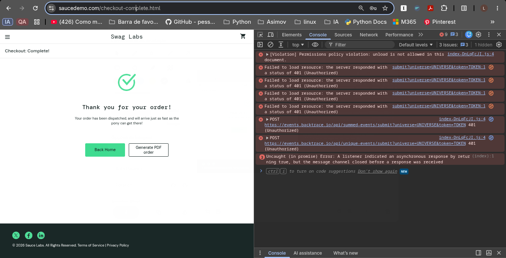

# Relatório de Execução de Teste - Fluxo de Carrinho e Checkout

## Informações gerais

- **Projeto:** SauceDemo E-Commerce
- **Funcionalidade:** Carrinho de compras e checkout ponta a ponta
- **Responsável pelo registro:** Lucas Mottola
- **Resultado dos casos documentados:** 4 de 4 passaram

## Resumo da cobertura

| ID | Cenário de teste | Tipo | Resultado observado | Status |
|---|---|---|---|---|
| CT-001 | Realizar compra de múltiplos produtos com sucesso | Funcional / E2E | Compra concluída e confirmação exibida | PASS |
| CT-002 | Validar que First Name é obrigatório no checkout | Regra de negócio | `Error: First Name is required`; formulário permaneceu no checkout | PASS |
| CT-003 | Validar que Last Name é obrigatório no checkout | Regra de negócio | `Error: Last Name is required`; formulário permaneceu no checkout | PASS |
| CT-004 | Validar que Postal Code é obrigatório no checkout | Regra de negócio | `Error: Postal Code is required`; formulário permaneceu no checkout | PASS |

Nos casos CT-002 a CT-004, somente o campo que estava sob teste foi deixado vazio. As capturas mostram a mensagem correspondente e a rota `/checkout-step-one.html`.

## Evidências visuais

### CT-001 - Produtos adicionados

### CT-002 - First Name obrigatório

### CT-003 - Last Name obrigatório

### CT-004 - Postal Code obrigatório

### CT-001 - Compra finalizada

