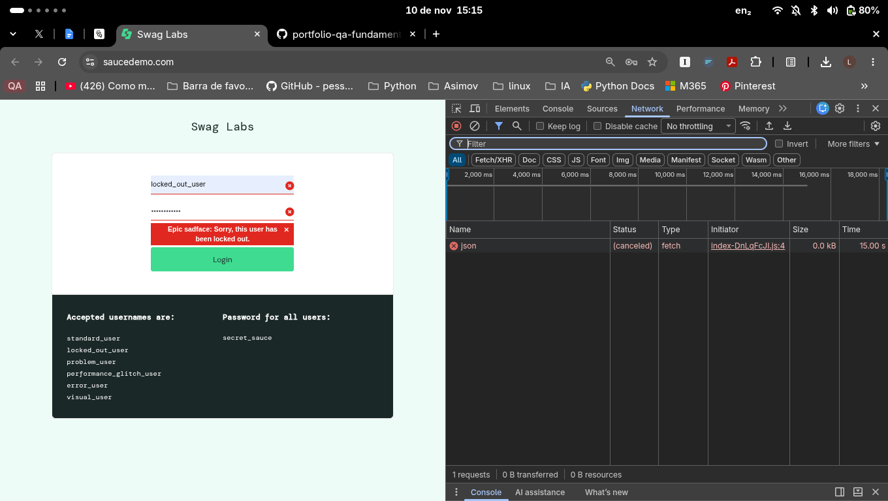
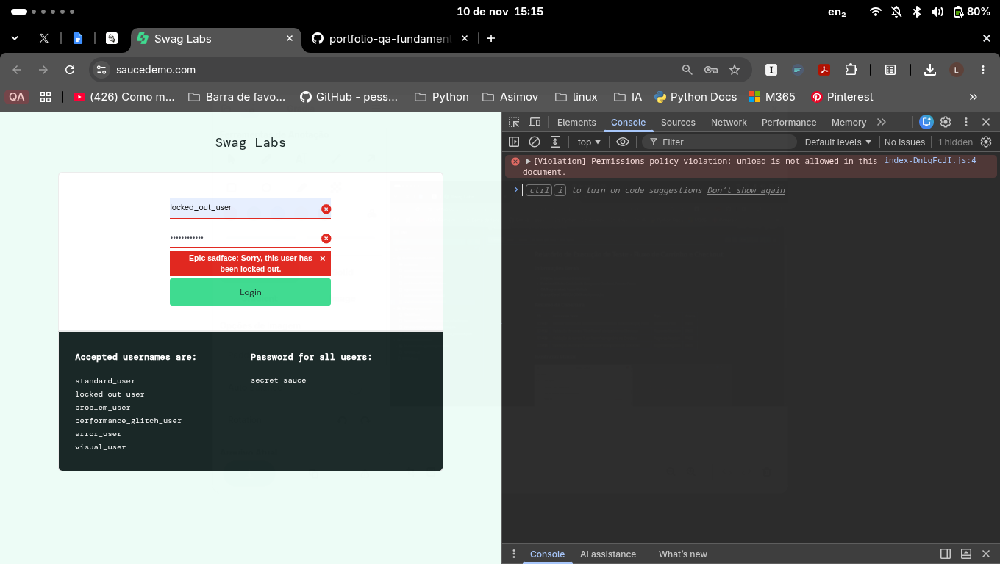

# Relatório de Execução de Teste - Login com Usuário Bloqueado

## Informações Gerais

* **Projeto:** SauceDemo E-Commerce
* **Funcionalidade:** Autenticação / Login
* **QA Responsável:** Lucas Mottola
* **Data do Teste:** 10/11/2026
* **Status Geral:** PASSOU (1/1 cenário de interface)

## Resumo da Cobertura

| ID | Cenário de Teste | Tipo | Status |
| :--- | :--- | :--- | :--- |
| CT-LOGIN-001 | Recusa de acesso para usuário bloqueado e exibição da mensagem | Funcional / Manual | PASS |

## Resultado da Execução

* **Resultado Esperado:** O sistema deve recusar o acesso, permanecer na página de login e exibir a mensagem "Epic sadface: Sorry, this user has been locked out."
* **Resultado Obtido:** O acesso foi recusado e a mensagem esperada foi exibida na página de login. O texto apareceu em duas linhas e permaneceu visível.
* **Status:** PASS

## Observações do DevTools

* **Network:** A requisição `json` apareceu como `(canceled)`, com `0 B` transferidos. Não foi possível confirmar um status HTTP nesta captura.
* **Console:** Foi exibido um aviso de `Permissions Policy` relacionado a `unload`. Nesta execução, não há evidência de que esse aviso tenha afetado o resultado do login.

## Evidências Visuais

