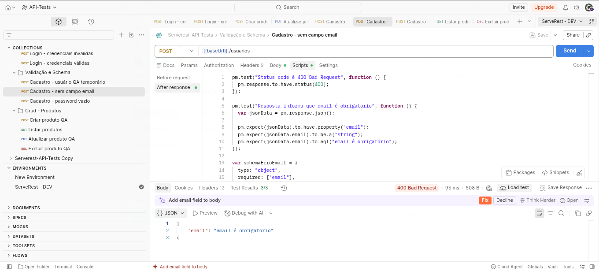

# Projeto 2.3 - Cadastro sem campo obrigatório

## Objetivo

Verificar se a API rejeita o cadastro de um usuário quando a propriedade `email` não é enviada e se identifica esse campo como obrigatório na resposta.

## Ambiente e requisição

- **API:** ServeRest
- **Ambiente:** `ServeRest - DEV`
- **Método:** `POST`
- **Endpoint:** `{{baseUrl}}/usuarios`
- **Autorização:** No Auth
- **Corpo:** JSON de teste sem a propriedade `email`
- **Dados:** fictícios

## Caso de teste

| ID | Cenário | Resultado esperado | Resultado obtido | Status |
|---|---|---|---|---|
| TC-API-2.3-001 | Enviar cadastro sem `email` | HTTP 400 e indicação de que `email` é obrigatório | HTTP 400; resposta informa `email é obrigatório` | PASSOU |

## Verificações executadas no Postman

1. `Status code é 400 Bad Request` - PASSOU
2. `Resposta informa que email é obrigatório` - PASSOU
3. `Resposta de erro segue o schema de email obrigatório` - PASSOU

**Resultado:** 3 de 3 verificações aprovadas.

## Schema validado

A resposta de erro observada tem a propriedade `email` do tipo string. O schema usado para validar essa estrutura é:

```json
{
  "type": "object",
  "required": ["email"],
  "properties": {
    "email": {
      "type": "string"
    }
  }
}
```

## Observação

Na primeira tentativa, a URL continha um espaço no final, representado como `%20`, e a API informou que aquela rota não aceitava a requisição. A URL foi corrigida antes da execução registrada neste caso. Essa tentativa não foi considerada falha da API.

## Escopo e limitações

Este caso valida somente a ausência da propriedade `email`. Não verifica outros campos, formatos de endereço ou outras regras de cadastro.

## Evidência


